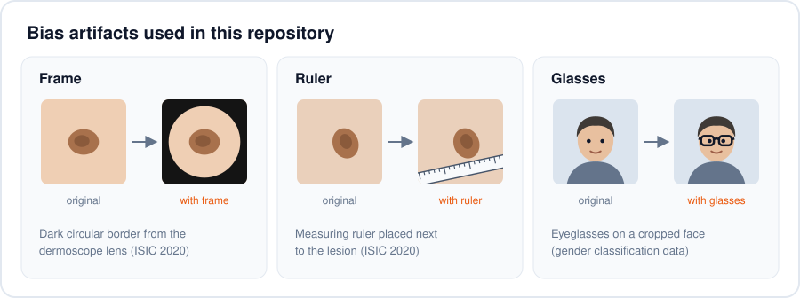
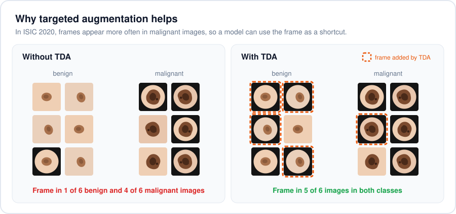
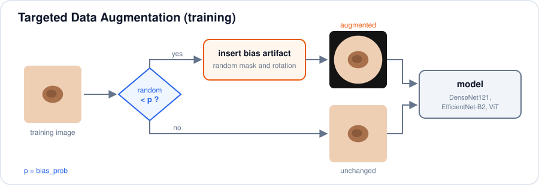
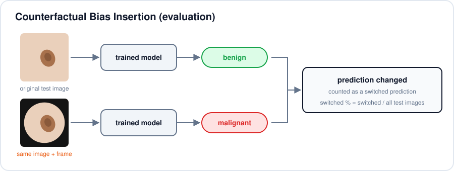

# Targeted Data Augmentations for Bias Mitigation


## Overview

This repository contains the code and resources for the paper:

**"Targeted Data Augmentation for Improving Model Robustness"**

The project introduces a method called **Targeted Data Augmentation (TDA)** for reducing bias in computer vision models. The code includes TDA and **Counterfactual Bias Insertion (CBI)**, the method used to measure how much a bias affects a model's predictions.





## Table of Contents

- [Overview](#overview)
- [Features](#features)
- [Project Structure](#project-structure)
- [Datasets](#datasets)
- [Requirements](#requirements)
- [Installation](#installation)
- [Usage](#usage)
  - [Data Preparation](#data-preparation)
  - [Configuration](#configuration)
  - [Targeted Data Augmentation (TDA)](#targeted-data-augmentation-tda)
  - [Training Models](#training-models)
  - [Counterfactual Bias Insertion (CBI)](#counterfactual-bias-insertion-cbi)
  - [Analyzing CBI Results](#analyzing-cbi-results)
- [Contributing](#contributing)
- [License](#license)
- [FAQs](#faqs)

## Features

- **Targeted Data Augmentation (TDA):** reduces bias by inserting the bias artifact into training images at random, so it appears in every class.
- **Counterfactual Bias Insertion (CBI):** measures how often a model changes its prediction when only a bias artifact is added to a test image.
- Bias artifacts:
  - **Frames** (dark circular border from the dermoscope) on skin lesion images
  - **Hair** (short, medium, dense) and **rulers** on skin lesion images
  - **Glasses** on face images
- Any classification model from [timm](https://github.com/huggingface/pytorch-image-models). The experiments used:
  - DenseNet121 (`densenet121`)
  - EfficientNet-B2 (`efficientnet_b2`)
  - Vision Transformer (`vit_base_patch16_224`)

## Project Structure

```
├── assets/                      # README illustrations
├── config.yml                   # paths, training plan and CBI plan
├── requirements.txt
├── LICENSE
├── train.py                     # trains models with and without TDA
├── cbi.py                       # runs Counterfactual Bias Insertion on saved models
├── datasets/
│   ├── transforms.py            # transforms without bias insertion (baseline training)
│   ├── transforms_aug.py        # transforms with bias insertion (TDA and CBI)
│   ├── transforms_infer.py      # standard augmentations (flips, colour, cutout)
│   ├── frame_transform.py       # RandomFrameTransform
│   ├── hair_transform.py        # RandomHairTransform (hair and rulers)
│   └── glasses_transform.py     # RandomGlassesTransform
├── models/
│   └── model.py                 # LesionClassification (PyTorch Lightning + timm)
└── utils/
    ├── analyze_data.py          # aggregates CBI results into an Excel file
    ├── sampler_utils.py         # class weights for the weighted sampler
    ├── rand_split.py            # splits ISIC 2020 into train and test folders
    ├── load_csv.py              # moves images into class folders from a CSV
    ├── move_matching_ims.py     # copies images that have a matching mask
    └── resize_all.py            # resizes masks to 768x768
```

The scripts in `utils/` are one-off data preparation helpers. Their paths are hard-coded, so edit them before running.

## Datasets

- **ISIC 2020 skin lesion dataset:** dermoscopic images labelled benign or malignant, originally from the [Kaggle SIIM-ISIC Melanoma Classification Challenge](https://www.kaggle.com/c/siim-isic-melanoma-classification/data).
- **Gender classification dataset:** cropped face images labelled by gender, originally from the [Kaggle Gender Classification Dataset](https://www.kaggle.com/datasets/cashutosh/gender-classification-dataset).
- **Masks for augmentation:** frame, hair, ruler and glasses masks.
- **Manual bias annotations** for both datasets.

The masks, annotations and prepared datasets are available in the [Data Repository](https://mostwiedzy.pl/pl/open-research-data/bias-mitigation-benchmark-that-includes-two-datasets,227084836236401-0?_share=322e9564d0341d8a).

## Requirements

- Python 3.7 or higher
- PyTorch and torchvision
- PyTorch Lightning 1.x (the code uses `gpus=` and `validation_epoch_end`, which were removed in 2.0)
- timm, efficientnet_pytorch
- albumentations
- Pillow below 10 (the code uses `Image.ANTIALIAS`, which was removed in Pillow 10)
- NumPy, pandas, scikit-learn, scikit-plot, Matplotlib, PyYAML, tqdm
- neptune-client (training logs go to [Neptune](https://neptune.ai))
- openpyxl (only for `utils/analyze_data.py`)

A GPU is required. `cbi.py` and the validation step move tensors to CUDA.

## Installation

1. **Clone the repository**

   ```bash
   git clone https://github.com/AgaMiko/targeted-data-augmentations.git
   cd targeted-data-augmentations
   ```

2. **Set up a virtual environment (optional but recommended)**

   ```bash
   python -m venv venv
   source venv/bin/activate  # On Windows: venv\Scripts\activate
   ```

3. **Install the requirements**

   ```bash
   pip install -r requirements.txt
   ```

4. **Set your Neptune API token** (used by `train.py`)

   ```bash
   export NEPTUNE_API_TOKEN="your-token"
   ```

## Usage

### Data Preparation

Images are loaded with `torchvision.datasets.ImageFolder`, so each split needs one folder per class. With the default `config.yml`, the layout is:

```
data/skin-lesion/
├── kaggle/archive/train/
│   ├── train/                # training images
│   │   ├── benign/
│   │   └── malignant/
│   └── val/                  # test images, also used by CBI
│       ├── benign/
│       └── malignant/
└── aug/
    ├── source_merged/        # images that hair and ruler pixels are copied from
    ├── mask_merged/          # hair and ruler masks used in training
    ├── frames-aug/           # frame masks used in training
    ├── frame/                # frame masks used in CBI
    ├── hair-short/           # hair masks used in CBI
    ├── hair-medium/
    ├── hair-dense/
    └── hair-ruler/           # ruler masks used in CBI
```

Masks are `.jpg` files (`.png` for glasses). Each hair or ruler mask must have the same file name as its source image in `source_merged/`.

### Configuration

Both scripts read `config.yml` (or another file passed with `--model_config_path`).

- `general`: data paths, GPUs, number of epochs, gradient accumulation, the folder for saved models and the Neptune project name.
- `mask_dirs`: mask folders for training (`train`) and for CBI (`test`), plus `source_dir` for hair and ruler source images.
- `training_plan`: which architectures, bias types and probabilities `train.py` loops over.
- `cbi_plan`: which saved models, bias types and masks `cbi.py` tests, and where it writes results.

### Targeted Data Augmentation (TDA)

TDA inserts a bias artifact (a frame, hair, a ruler or glasses) into a training image with probability `p`. Because the artifact then appears in images of every class, the model can no longer use it to tell the classes apart.



Each artifact has its own transform in `datasets/`. All of them work the same way:

1. Draw a random number. If it is above `p`, return the image unchanged.
2. Pick a mask: a random one during training, or a fixed one (`mask_nr`) during CBI.
3. Optionally rotate the mask by a random angle (`rotate=True` in training, `False` in CBI).
4. Paste the artifact into the image using the mask.

| Transform | Bias type names | How the artifact is inserted |
|---|---|---|
| `RandomFrameTransform` | `frame` | Resizes a frame mask to the image size and pastes it over the image. |
| `RandomHairTransform` | `hair_short`, `hair_medium`, `hair_dense`, `ruler`, `hair_and_ruler` | Copies the hair or ruler pixels from the matching source image in `source_dir`. |
| `RandomGlassesTransform` | `glasses` | Resizes a glasses mask to the image width and pastes it across the upper part of the face. |

`get_transforms()` in `datasets/transforms_aug.py` builds the full pipeline: bias insertion, resize, centre crop and normalisation.

### Training Models

```bash
python train.py --model_config_path config.yml
```

`train.py` trains one model for every combination in `training_plan`:

- each architecture in `architectures.names`
- each bias type in `augmentations` (`normal` means no TDA)
- each probability in `probabilities` (`normal` is trained only once, with `p = 0`)

For example, this plan trains a ViT once without TDA and four times each with `hair_and_ruler` and `frame` TDA:

```yaml
training_plan:
    architectures:
      names: ["vit_base_patch16_224"]
      input_sizes: [224]
      batch_sizes: [16]
    probabilities: [0.25, 0.5, 0.75, 1.0]
    augmentations: ["hair_and_ruler", "frame", "normal"]
```

Training details:

- Adam optimiser, learning rate `1e-5`, multiplied by 0.9 after each epoch
- A weighted random sampler (weights 0.2 for benign, 0.8 for malignant) to deal with class imbalance
- Checkpoints are saved to `saved_models/<model>_<bias type>_<p>/` (lowest validation loss) and `saved_models/<model>_<bias type>_<p>.ckpt` (final model)

### Counterfactual Bias Insertion (CBI)

CBI answers one question: **if the only change to an image is an added bias artifact, does the model change its prediction?**

A model that has learned the correct features should give the same answer for a lesion with or without a frame. A model that has learned "frame means malignant" will switch some benign predictions to malignant once a frame is added. CBI counts these switches.



**How it works**

For each test image, CBI makes two versions:

- the **original** image
- a **counterfactual** image: the same image with the bias artifact inserted

Both go through the same trained model. If the two predicted classes differ, the image counts as a **switched prediction**.

To keep the comparison fair, the counterfactual images are made in a fixed way:

- every test image gets the artifact (`p = 1.0`)
- the same mask is used for every image in a run (`mask_nr`)
- the mask is not rotated

`cbi.py` repeats the test for every mask listed in `masks_to_test`. This shows whether the result depends on one particular mask.

**Metrics**

| Metric | Meaning |
|---|---|
| `switched` | Number of test images whose predicted class changed after inserting the artifact. Divide by the number of test images to get the switched percentage. |
| `ben_to_mal` | Switches from benign to malignant. |
| `mal_to_ben` | Switches from malignant to benign. |
| `f1`, `recall`, `precision` | Scores on the original test images. |
| `f1_aug`, `recall_aug`, `precision_aug` | Scores on the counterfactual test images. |

**How to read the results**

- A low `switched` count means the artifact has little effect on the model's predictions.
- A high `switched` count means the model relies on the artifact.
- The direction shows what the model has learned. In ISIC 2020, frames are more common in malignant images, so a biased model shows a high `ben_to_mal` count when frames are added.
- A large drop from `f1` to `f1_aug` means the artifact also hurts accuracy, not only individual predictions.
- To see whether TDA helped, compare the same architecture trained with `normal` and with TDA. The TDA model should have fewer switched predictions.

**Running CBI**

```bash
python cbi.py --model_config_path config.yml
```

`cbi.py` loads every checkpoint matching `saved_models/*/*.ckpt` and reads the architecture, bias type and `p` from the folder name. It tests each model with the bias types in `cbi_plan.augmentations` that match the bias type the model was trained with. For example, a model trained with `hair_and_ruler` is tested with `hair_short`, `hair_medium`, `hair_dense` and `ruler`.

```yaml
cbi_plan:
    architectures:
      names: ["efficientnet_b2", "densenet121", "vit_base_patch16_224"]
      input_sizes: [224, 256, 224]
      batch_sizes: [4, 4, 4]
    dir_to_saved_models: "saved_models/"
    augmentations: ["frame", "hair_short", "hair_medium", "hair_dense", "ruler"]
    results_path: "cbi_results.tsv"
    save_preds_dir: "results/"
    masks_to_test: [0, 1, 2, 3, 4]
```

**Output**

- `cbi_results.tsv`: one row per model, bias type and mask, with the columns `model, aug_type, p, switched, mal_to_ben, ben_to_mal, f1, f1_aug, recall, recall_aug, precision, precision_aug, path, mask_nr`. Despite the extension, the file is comma-separated.
- `results/<model folder>.csv`: predicted probabilities for the original and counterfactual images.

The core of the comparison is `switched_score()` in `cbi.py`:

```python
from cbi import switched_score

# pred_clean: predicted classes for the original images
# pred_biased: predicted classes for the same images with the artifact inserted
switched, ben_to_mal, mal_to_ben = switched_score(pred_clean, pred_biased)
```

### Analyzing CBI Results

```bash
python utils/analyze_data.py
```

This reads `cbi_results.tsv` and writes `aggregated_cbi_results.xlsx`, with sheets that group the results by model, bias type, probability `p` and mask number, plus standard deviations and descriptive statistics.

## Contributing

Contributions are welcome! Please open an issue or submit a pull request for any improvements or bug fixes.

## License

This project is licensed under the MIT License. See the [LICENSE](LICENSE) file for details.

## FAQs

### Q: What is the purpose of TDA and how does it reduce bias?

**A:** TDA inserts the bias artifact into training images at random, in every class. The artifact then appears with benign and malignant images alike, so the model cannot use it to predict the class and has to rely on the lesion itself.

### Q: How is CBI different from TDA?

**A:** TDA is used during training to reduce bias. CBI is used after training to measure bias: it adds the artifact to test images and counts how many predictions change.

### Q: Can I use my own dataset with TDA and CBI?

**A:** Yes. Put your images in one folder per class, provide masks for the bias you want to study, and set the paths in `config.yml`. If your bias needs a different way of inserting it, add a transform in `datasets/` and a matching branch in `get_transforms()` in `datasets/transforms_aug.py`.
